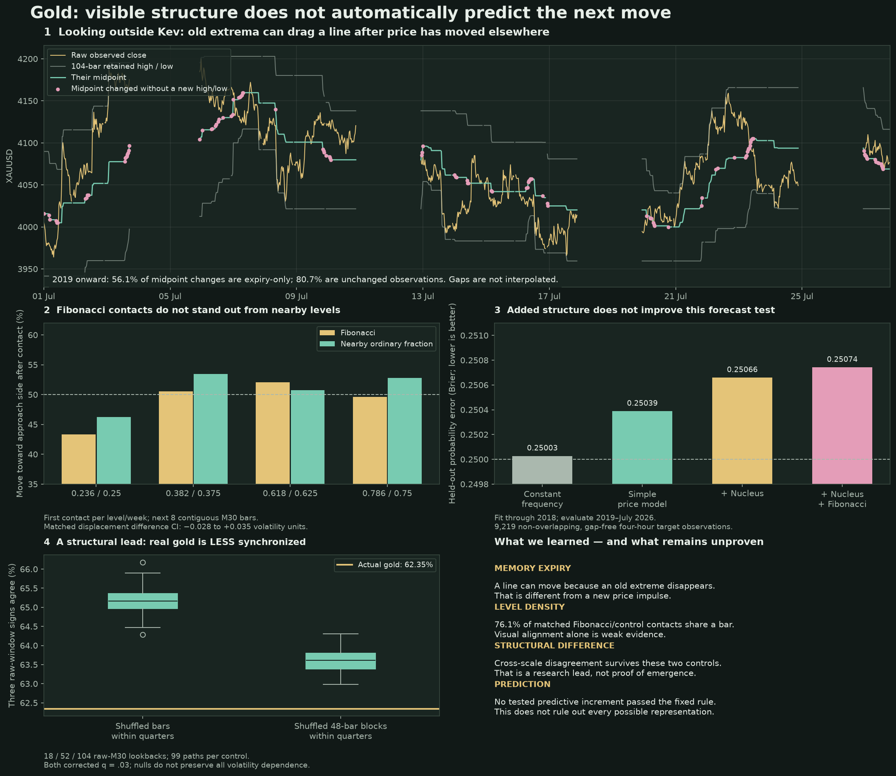

# Gold: predictive information and raw-price organization

Run on 2026-10-23 against 200,000 bundled M30 gold bars. The user asked for observations and possible emergent organization, not a profitable strategy.

[Visual explanation (PDF)](visuals/gold-information-study.pdf) · [Full-size image](visuals/gold-information-study.png) · [Numerical results](gold-information-study-results.json)



## What the tests say

No tested predictive addition passed the fixed decision rule. There is a descriptive structural lead: actual gold has less agreement between raw lookback scales than either shuffled control. This is not proof of emergence or a forecast.

## Independent look at the raw path

This part uses raw high, low and close, without the Kev graph or Nucleus features. Three rolling lookbacks contain 18, 52 and 104 observed M30 bars; these are raw windows, not four independently sampled timeframes.

- Across 2019 onward, the 104-bar midpoint stays unchanged on **80.65%** of adjacent observed closes.
- Of **16,926 midpoint changes**, **9,495 (56.10%)** happen without the current bar making a new high or low against the preceding window. Their cause is an old boundary leaving the finite window.
- A moving range summary can therefore be a **memory-expiry event**, rather than a fresh market impulse. This is a mathematical mechanism observed frequently in this gold dataset, not a market law.
- The July 2026 plot is a descriptive example chosen as the last available month. Lines break at absent observations. No price path inside a gap is inferred.

## Fibonacci contacts versus nearby ordinary fractions

Each UTC week freezes a range from the preceding 96 observed M30 bars. The current bar cannot define its own reference. Ratios are measured low-to-high; anchors remain fixed within the week. Only the first contact per ratio/week is used. Eligibility also requires a contiguous previous bar and eight contiguous future bars for the label.

Outcome is the price movement **after the contact becomes observable at its close**, over the next four hours. “Toward approach side” means movement toward the side from which price arrived; it is not a simulated fill or an inferred intrabar bounce.

| Fib ratio | Eligible contacts | Next close up | Next close down | Toward approach side | Control ratio | Control contacts | Control toward approach side |
|---|---:|---:|---:|---:|---|---:|---:|
| 0.236 | 247 | 122 | 125 | 43.3% | 0.25 | 253 | 46.2% |
| 0.382 | 269 | 141 | 128 | 50.6% | 0.375 | 273 | 53.5% |
| 0.618 | 269 | 132 | 137 | 52.0% | 0.625 | 268 | 50.7% |
| 0.786 | 274 | 152 | 122 | 49.6% | 0.75 | 267 | 52.8% |

Totals: **1,059 Fibonacci contacts**, **1,061 control contacts**. Of **1,014 matched week/ratio-pair/approach-side comparisons**, **76.1% happen in the same source bar**. Multiple level alignments frequently describe the same observed range. Different levels touched inside one bar have unknown internal ordering.

Matched subsequent displacement difference (Fib minus ordinary fraction): **0.0035 volatility units**, 95% block-bootstrap interval **[-0.0278, 0.0349]**, corrected **q=0.825**. The estimate changes sign between 2019–2022 and 2023 onward. No reliable Fibonacci advantage.

Close-price occupancy within ±0.005 of anchor width around any tested ratio is **2.252% for Fibonacci versus 2.269% for the ordinary fractions**. This is descriptive, not an independent significance test.

## Chronological predictive test

Fit through 2018, honoring the effective gold override; evaluate 2019 through July 2026. There are **11,385 fitting observations and 9,219 evaluation observations**, on a fixed non-overlapping eight-observation grid after excluding horizon gaps. Features use closed observations only; later prices are labels. The historical data had been examined in prior work, so this is retrospective chronological evaluation, not pristine unseen confirmation.

Baseline: recent normalized price moves, volatility ratio and fixed weekly-range coordinate/width. Nucleus adds four timeframe balances, slope balance and twelve line positions. Fib and ordinary-fraction models use equally sized four-component proximity representations. Fixed ridge logistic regression, no holdout tuning.

| Model | Features | Held-out Brier error ↓ | Held-out direction accuracy |
|---|---:|---:|---:|
| Simple price baseline | 7 | 0.250388 | 49.85% |
| Baseline + Nucleus | 24 | 0.250659 | 50.16% |
| Baseline + Nucleus + Fib | 28 | 0.250742 | 50.15% |
| Baseline + Nucleus + ordinary fractions | 28 | 0.250946 | 50.10% |
| Baseline + Fib | 11 | 0.250477 | 49.90% |

A constant probability using the fitting-period upward frequency scores **0.250027 Brier**. A fixed 50/50 forecast scores 0.25. Accuracy alone obscures probability calibration: Nucleus is approximately 50.2% correct, while its Brier score is worse than the simple baseline.

Five predeclared comparisons (four model increments and the matched contact comparison) use four-calendar-week moving-block bootstrap intervals and Benjamini–Hochberg correction. None passes the favorable effect/CI/q/subperiod consistency rule. The Fib model nominally beats the ordinary-fraction model in one comparison, but **q=0.250**, and both are worse than the model without either addition. It is not evidence of a special Fibonacci effect.

## Organization compared with shuffled paths

Control A shuffles individual return/bar-geometry pairs within quarters. Control B shuffles 48-observation blocks within quarters. Both keep actual timestamps, gaps and quarter endpoints/drift, and re-quantize to gold ticks. Neither preserves all real volatility/calendar dependencies. Each control has 99 realizations; minimum two-sided empirical p is 0.02. Correction covers six metric/control comparisons.

| Raw property | Actual gold | Shuffled bars: median [95% range] | Shuffled 48-bar blocks: median [95% range] | Corrected q: bars / blocks |
|---|---:|---:|---:|---|
| 104-bar midpoint persistence | 80.65% | 79.78% [79.28%, 80.55%] | 80.27% [79.86%, 80.71%] | 0.072 / 0.140 |
| 18/104-bar shared extreme fraction | 23.61% | 26.82% [26.06%, 27.41%] | 24.83% [24.36%, 25.35%] | 0.030 / 0.030 |
| 18/52/104-bar same-side agreement | 62.35% | 65.16% [64.53%, 65.85%] | 63.61% [63.07%, 64.17%] | 0.030 / 0.030 |

The noteworthy direction is **less agreement**, not unusual synchronization. Real gold has more disagreement between the short and long representations than these controls. This may reflect mean reversion, volatility organization or other dependence the nulls fail to retain; this study does not identify the mechanism. It is a candidate descriptive difference that passed these two limited controls, not proof of a new emergent property or exploitable prediction.

Midpoint persistence itself is not exceptional against the 48-bar-block control. A long-lived line is largely consistent with the construction of overlapping extrema windows.

## What this changes in the observatory

- Keep fresh extrema events separate from old-extreme expiry when interpreting a moving line.
- Keep fixed price identities and original anchors: they let later activity be compared with the same historical coordinate.
- Do not count many simultaneous Fib contacts as independent confirmations.
- Investigate cross-scale disagreement as a descriptive candidate. Do not label it predictive without a new predeclared, independent validation.
- The present negative forecast result applies to these features, this anchor, this model and this four-hour horizon; it does not rule out every possible representation.

## Reproduce and validate

```sh
python kev-lab/gold_information_study.py
# Optional figure dependencies: matplotlib (tested with 3.11.2).
python kev-lab/gold_information_plot.py
python -m unittest discover -s kev-lab/tests -v
```

[Fixed plan, written before executing these outcomes](../kev-brain/experiments/2026-10-23-gold-information-plan.md). The reusable script does not import the Kev node graph; only the separate predictive increment reads Nucleus features. Raw-path, contact and surrogate analyses use raw prices directly. There are no orders, account returns or optimized trading thresholds.
