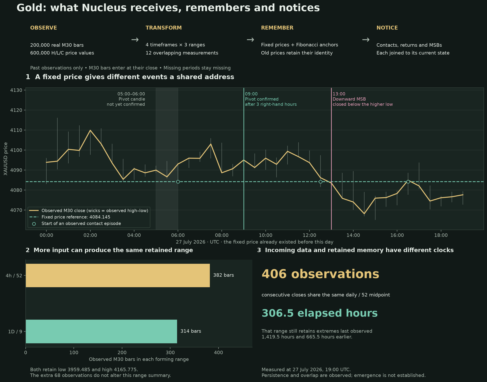

# Gold observations: initial findings

[Download the visual explanation (PDF)](visuals/gold-explained.pdf)



Computed locally from `data/XAUUSD_m30.json` at the final observed close,
**2026-07-27 19:00 UTC**. Reproduce with:

```sh
python kev-lab/gold_observatory.py --asof 2026-07-27T19:00:00Z --out out/nucleus/gold-observatory.json
```

These are descriptive observations at a cutoff, not validated emergent properties.

## Different scales can retain identical information

Twelve lines have ten distinct midpoint values at this cutoff.

| Lines | Common low | Common high | Common midpoint | M30 observations consumed |
|---|---:|---:|---:|---:|
| 30m/52 and 1h/26 | 4048.995 | 4116.145 | 4082.570 | 52 each |
| 4h/52 and 1D/9 | 3959.485 | 4165.775 | 4062.630 | 382 versus 314 |

The first pair has the same underlying observation support at this cutoff, so
agreement is an expected aggregation dependency. The second pair consumes different
amounts of history yet retains exactly the same extremes. The extra 68 observations
in the larger window do not change that range summary. That does not mean those
observations contain no other information; the summary discards their other detail.

## Old boundaries can outlast many new observations

The 1D/52 forming range consumes 1,954 M30 observations spanning 1,459 wall-clock
hours. Its midpoint is 4268.0965. It has remained unchanged across 406 observed
closes spanning 306.5 hours. The last observed high and low defining its range
are respectively 1,419.5 and 665.5 hours old.

Thus input arrival, retained-boundary age and midpoint update rate are different
quantities. A new input need not change a retained summary. Persistence is measured
here; it does not establish that a boundary will remain relevant later.

## Joint order states show persistence, with important dependencies

In the preceding 30 calendar days there are 954 observed order states, 78 distinct
joint configurations and 933 adjacent M30 pairs. The joint state changes on 15.11%
of those pairs. Empirical state entropy is 5.573 bits; conditional entropy over
adjacent pairs is 0.667 bits. The latest state has persisted for five consecutive
observations over two hours.

These estimates do not establish emergence. Shared price inputs, overlapping
windows, discrete ties and small samples all affect them. No null-model comparison
or forecasting experiment was run. Entropies here use different sample populations
when gaps exist, so their difference is not reported as mutual information.

## Fixed references and MSB events

At the same final observation, the trailing 30-day replay detects 65 MSBs:
41 on 30m, 19 on 1h, four on 4h and one on 1D. These are counts under the
repository's lower-high/higher-low break definition with three bars on each
side confirming a pivot; overlapping timeframe events are not independent.

The latest detected MSB is a 1h downward close through 4084.145 at
2026-07-27 13:00 UTC. The pivot candle opened at 05:00 UTC and its confirmation
became available at 09:00 UTC. Confirmation and break are distinct timestamps.

Some fixed price identities have recorded origins on all four timeframes.
One reference can therefore accumulate multiple timeframe/Ichimoku/Fibonacci
origins without representing multiple independent price observations. No null
model or significance claim has been added for these coincidences.
