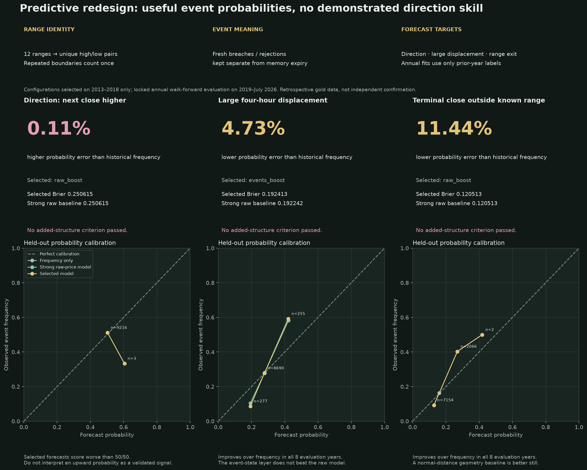

# Gold predictive redesign: what improved, and what did not

[Visual report (PDF)](visuals/gold-predictive-redesign.pdf) · [Full-size image](visuals/gold-predictive-redesign.png) · [Numerical results](gold-predictive-redesign-results.json)



The user authorized independent structural changes to make the observation system more predictive. The result is a causal predictive state layer and three event-probability outputs, with explicit evidence limits. **Magnitude and terminal-range-exit forecasts improve against historical frequency. No added-structure criterion passes, and direction remains unsupported.**

## Structural changes

1. Keep the existing fixed-price/Fibonacci observatory and its event archive.
2. Compute 12 prior closed ranges (30m/1h/4h/UTC 1D × 9/26/52). Identical high/low pairs contribute once to aggregate measurements; twelve overlapping views cannot manufacture twelve independent confirmations.
3. Separate fresh upper/lower breaches, close-confirmed rejections and acceptance from retained upper/lower boundary expiry. The current source bar cannot define its own prior reference.
4. Add retained-boundary age and cross-scale disagreement. Fib context retains a fixed weekly anchor and observed contacts without assuming intrabar ordering.
5. Separate observation/state extraction from research labels and fitted forecasting. Annual model updates use only the previous three calendar years, with labels purged before the next year.
6. Select probability outputs, rather than an assumed buy/sell rule. Every API forecast declares its training-label cutoff, horizon, baseline and experimental status.

## Locked experiment

Five configurations were selected on annual 2013–2018 development folds only: adaptive prevalence, regularized raw logistic, raw shallow boosting, deduplicated event-state boosting, and event-state/Fib boosting. Boosting is fixed at depth 2, four leaves, 100 iterations, minimum leaf 100 and L2=10. Nonconstant predictions are half-shrunk toward the fitting-window prevalence. There was no holdout parameter search.

The selected configuration for each target was then locked and evaluated year by year from 2019 through July 2026. Annual retraining on earlier evaluation years is part of the predeclared adaptive policy; no later year labels enter an earlier year fit. This is still retrospective research on already inspected gold history, not independent future confirmation.

The raw baseline includes price returns, volatility, range distances, candle close-location/range, fixed weekly coordinate, calendar phase and gap duration. This prevents a weak raw baseline from making event semantics look uniquely predictive.

## Results: lower Brier probability error is better

| Four-hour target | Selected configuration | Observations | Historical frequency Brier | Selected Brier | Strong raw-price Brier | Error reduction vs frequency |
|---|---|---:|---:|---:|---:|---:|
| Next close higher | raw_boost | 9219 | 0.250337 | 0.250615 | 0.250615 | -0.11% |
| Large displacement | events_boost | 9222 | 0.201960 | 0.192413 | 0.192242 | 4.73% |
| Terminal range exit | raw_boost | 9222 | 0.136076 | 0.120513 | 0.120513 | 11.44% |

- **Large displacement:** probability error falls **4.73%** against historical frequency, with favorable effects in both time halves and all eight evaluation years. It also improves over raw logistic, but is slightly worse than raw boosting. The new event representation therefore does not demonstrate unique predictive information.
- **Terminal range exit:** error falls **11.44%** against historical frequency in all eight years. The selected model is the raw boosting baseline itself, not the added event/Fib layer. A simple normal-distance geometry baseline scores **0.112615**, better than the selected model’s **0.120513**; it remains visible as a diagnostic rather than being selected after seeing evaluation scores.
- **Direction:** the development winner fails in the later years. It scores **0.250615**, worse than a 50/50 probability forecast (**0.250000**). The paired worsening interval excludes zero; no direction claim is warranted.
- The event/Fib configuration was not selected for any target. It remains available as a research configuration; no Fibonacci-specific forecasting advantage is claimed.

## Paired uncertainty and the stricter structure criterion

Ten primary comparisons use 1,000 four-calendar-week moving-block bootstrap draws and BH correction. Differences below are selected minus baseline Brier: negative is favorable.

| Target | Baseline | Mean difference | 95% interval | q | Improving evaluation years |
|---|---|---:|---|---:|---:|
| Next close higher | prior | 0.000278 | [-0.000039, 0.000611] | 0.1484 | 3/8 |
| Next close higher | raw_logistic | 0.000244 | [-0.000100, 0.000590] | 0.2085 | 2/8 |
| Next close higher | raw_boost | 0.000000 | [0.000000, 0.000000] | 1.0000 | 0/8 |
| Next close higher | half | 0.000615 | [0.000220, 0.001057] | 0.0080 | 1/8 |
| Large displacement | prior | -0.009546 | [-0.010757, -0.008437] | 0.0025 | 8/8 |
| Large displacement | raw_logistic | -0.002275 | [-0.002973, -0.001594] | 0.0025 | 8/8 |
| Large displacement | raw_boost | 0.000171 | [-0.000000, 0.000317] | 0.0599 | 3/8 |
| Terminal range exit | prior | -0.015563 | [-0.016724, -0.014361] | 0.0025 | 8/8 |
| Terminal range exit | raw_logistic | -0.012900 | [-0.014010, -0.011828] | 0.0025 | 8/8 |
| Terminal range exit | raw_boost | 0.000000 | [0.000000, 0.000000] | 1.0000 | 0/8 |

The predeclared added-structure criterion requires improvement against frequency and both raw baselines, corrected q<.05, a wholly favorable interval, favorable effects in both time halves and at least six of eight improving years against raw boosting. Direction must also beat 50/50. **None passes.** Duplicated selected/raw models have exactly zero increment, not evidence of an added effect.

Improvement against historical frequency is useful conditional predictability, but it must not be relabelled as unique Nucleus information or trading profitability. All outputs remain explicitly experimental. High classification accuracy on uncommon events can result from always predicting “no event”; probability scores/calibration are used instead.

## Three target definitions

- Direction: closing price after eight contiguous M30 observations exceeds the current close. Exact zero-move training outcomes are excluded.
- Large displacement: absolute log-close move exceeds trailing-48-return standard deviation at the current observation × √8. The threshold is known at forecast time; it is not a future-volatility estimate.
- Terminal range exit: the future close is outside the high/low of the prior 104 observed M30 bars. This is not a first-touch forecast, future MSB confirmation, or intrabar barrier probability.
- The research discards horizons containing missing observations. A forecast cannot know future data availability: if a future gap occurs, eight observations may take longer than four wall-clock hours.

## Use the predictor

From the repository root, activate the development virtual environment and install the pinned Python dependencies:

```sh
python -m pip install -r kev-lab/requirements.txt
python kev-lab/server.py --port 8766
```

The gold page `/gold.html` includes the event-probability section. Its small standalone endpoint is:

```text
/api/gold/predictive
/api/gold/predictive?asof=2020-01-02T12:00:00Z
```

The endpoint truncates the source to bars closed by the requested time before state/label construction. It fits the locked model on only labels available before January 1 of the observation year. It returns no future outcome labels and no orders. Pre-2019 forecasts are unavailable because model selection uses development folds through 2018. The source ends on 2026-07-27; “latest” is the latest historical observation, not a live quote.

Each response includes unique-range count, fresh/expiry/rejection state, prior range boundaries, baseline frequencies, fitted-through dates and the normal-distance exit baseline. Selected probabilities can be poorly calibrated at extremes; the retrospective calibration plots show that limitation. No deployment or live-trading claim is made.

## Reproduce and verify

```sh
OMP_NUM_THREADS=4 OPENBLAS_NUM_THREADS=4 python kev-lab/gold_predictive_research.py
python kev-lab/gold_predictive_plot.py
python -m unittest discover -s kev-lab/tests -v
```

The research writes a locked development selection before entering evaluation. `gold-predictive-policy.json` records that selection for as-of inference; do not change it based on evaluation scores. Restart the server after changing source files or policy to clear its small response caches.

Validation includes future append/tampering invariance for state and complete as-of forecasts, prior-range availability, duplicate-range collapse, missing horizon slots, training-label purging and the pre-policy embargo. Current Python result: 50 tests, 48 pass, two skipped because separate SOL minute-data fixtures are unavailable. Browser checks cover forecast cards, fitted-through disclosure, historical cutoffs, pre-policy embargo, cleared stale cards and mobile layout.

[Experiment plan](../kev-brain/experiments/2026-10-23-gold-predictive-redesign-plan.md) · [Previous negative information study](gold-information-study.md)
