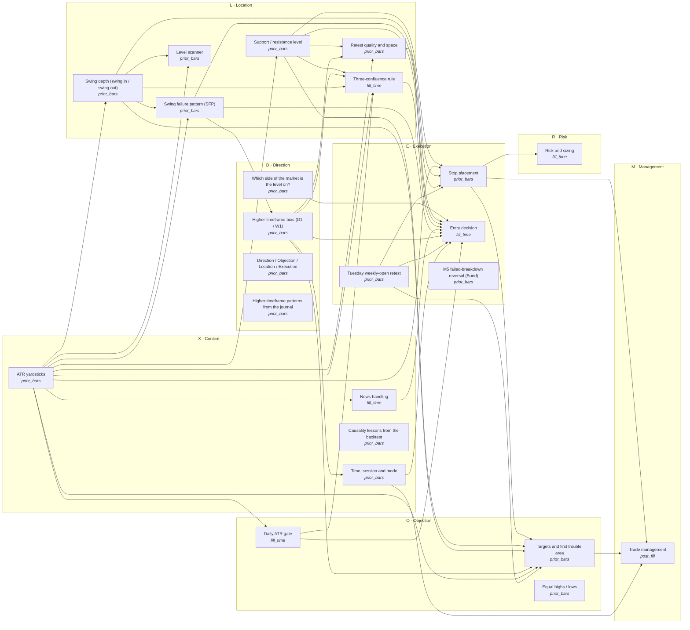

# The node graph

23 nodes, 43 wires. Order of evaluation: atr → swing-depth → sfp → tuesday-rto → level-scan → market-side → level → daily-bias → atr-gate → confluence → retest → news → context → stop → target → risk → entry → management → causality → equal-liquidity → framework → htf-patterns → ltf-reversal.

Every wire is checked at load: the producing node must be knowable no later than the consuming node decides. Phases, earliest to latest: prior_bars → bar_open → fill_time → bar_close → post_fill.

Rule-only cards (no wires): `framework`, `causality`, `htf-patterns`, `equal-liquidity`, `ltf-reversal`
